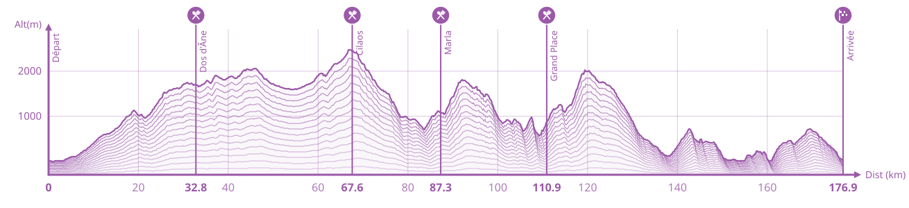

# GPX → Elevation profile

Turn a GPX track into a clean, race-style elevation profile and export it as **SVG** or **PNG**.
Everything runs in the browser — files are parsed and rendered client-side and never uploaded.



## Features

- **Drop or browse** a `.gpx` file, or **Try an example** (a bundled Diagonale des Fous sample) to see the output in one click.
- **Race-style rendering**: stacked contour lines, axes, grid, regular km labels, and a layered line style.
- **Markers**: start, finish, and any waypoints found in the GPX are added automatically; names, distances, and icons are editable (aid station, water, finish flag, start).
- **Style controls**: color, number of lines, line shift, width/height, grid, km labels, and transparent background.
- **Exports**: download as SVG or high-resolution PNG, with the display font embedded so the result renders identically anywhere.
- **Landing preview**: a "What you'll get" section shows a real, build-time render of the sample so visitors see the output before uploading.
- **Privacy**: all processing is local to the browser.

## Getting started

```bash
npm install
npm run dev
```

Open [http://localhost:3000](http://localhost:3000).

## Scripts

| Script | Description |
|---|---|
| `npm run dev` | Start the dev server (Turbopack). |
| `npm run build` | Production build (runs TypeScript). |
| `npm run start` | Serve the production build. |
| `npm run lint` | Run ESLint. |
| `npm run generate:preview` | Regenerate the landing-page preview SVG from the sample GPX. |

## How it works

The pipeline is the same whether you upload a file or load the example:

1. **Parse** — `src/lib/gpx.ts` reads the GPX. `parseGpx(xml)` handles the browser DOM extraction, then delegates to the pure, DOM-free `buildProfile(points, waypoints, name)` which computes cumulative distance (haversine), smooths elevation (distance-weighted moving average), and derives gain/loss, min/max, and projected waypoints.
2. **Render** — `src/components/ProfileChart.tsx` draws the profile as an SVG (stacked contour lines, axes, grid, labels, markers).
3. **Export** — `src/lib/export.ts` serializes the SVG with the font embedded and rasterizes it to PNG via canvas.

Default style and marker generation live in `src/lib/profile-defaults.ts` (`DEFAULT_OPTIONS`, `defaultMarkers`) and are shared by the editor and the preview generator, so the preview can never drift from the real output.

## Project structure

```
public/
  sample-diagonale-des-fous.gpx   Bundled sample course (Try an example)
  sample-preview.svg              Build-time landing preview (generated)
  fonts/SairaCondensed-SemiBold.ttf
scripts/
  generate-preview.tsx            Renders ProfileChart to the preview SVG
src/
  app/            page.tsx, layout, styles
  components/     ProfileChart.tsx, LandingPreview.tsx
  lib/            gpx.ts, export.ts, profile-defaults.ts, analytics.ts
```

## The sample and the preview

- **`public/sample-diagonale-des-fous.gpx`** — a simplified Diagonale des Fous route (~177 km, 0–2477 m, 6 waypoints), kept small for instant loading. It is a derived, simplified track from a public TraceDeTrail route; confirm redistribution rights before shipping, or swap in a self-made/open-licensed route (the `SAMPLE` constants in `src/app/page.tsx`).
- **`public/sample-preview.svg`** — generated by `npm run generate:preview`, which renders the real `ProfileChart` with the sample at the default style. **Regenerate it whenever the default style changes** so the landing preview stays accurate.

## Tech

Next.js 16 (App Router, Turbopack) · React 19 · TypeScript. Preview generation uses `tsx` (dev dependency).
